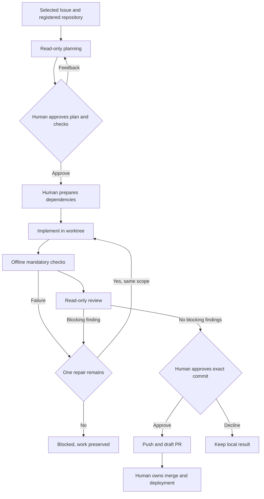

# Architecture

AgentGate is a local controller with explicit adapters around external tools. The first delivery is a CLI for one active run per state home. There is no server, database service, task queue service, or webhook listener.

## Components

| Component               | Responsibility                                                                                            |
| ----------------------- | --------------------------------------------------------------------------------------------------------- |
| `src/core/contracts.ts` | Zod validation and shared repository, plan, result, run, and adapter contracts.                           |
| `src/core/workflow.ts`  | Durable checkpoints, approvals, scoped execution, checks/review, repair budget, and publication.          |
| `src/core/store.ts`     | Local schema-validated state, atomic replacement, redacted event persistence, and exclusive process lock. |
| `src/core/safety.ts`    | Approval fingerprinting, scope boundaries, credential redaction, and safe terminal output.                |
| `src/adapters/`         | Argument-based process execution, Git/GitHub operations, Codex invocation, and native sandbox preflight.  |
| `src/cli/`              | Commands, repository registration, terminal rendering, and human decisions.                               |

The core uses `AgentRunner`, `SandboxRunner`, `GitHubGateway`, and `UserInteraction` interfaces so tests can exercise behavior with fake providers. These seams also leave room for a later web interface and Claude adapter without implementing either now.

## Task flow



Plan approval binds the run, repository identity and path, base commit/branch, Issue snapshot, worktree/branch, plan, and mandatory check specifications. Scope paths are exact repository-relative file paths or directory prefixes, without glob matching or parent traversal. A prefix such as `src` includes `src/a.ts` but not `src-other/a.ts`.

After implementation, checks and review refer to a source tree snapshot. If source changes, those results and the publication approval are invalidated. The controller creates and verifies a candidate commit, shows its diff and evidence, and binds publication approval to that exact commit. PR creation receives an explicit head branch; agents never run publication themselves.

Creating a remote branch uses an absent-only compare-and-swap: the Git lease expects no existing branch. Although Git spells this protection with `--force-with-lease=<ref>:`, an existing remote branch cannot be overwritten by that operation. Publication must either recognize an already matching approved result or stop on a conflicting branch/commit.

## State and recovery

The default state directory is `~/.agentgate`, overridden by `AGENTGATE_HOME` or `--home`. It is separate from every target repository:

```text
repos/<name>.json       Registered repository and exact check commands
runs/<uuid>.json        Versioned run, results, approvals, and checkpoint
events/<uuid>.jsonl     Redacted transition events
worktrees/<uuid>/      Isolated Git working directory
codex/                 Dedicated native Codex authentication profile
runtime/               Temporary controller-created launch/probe directories
run.lock               Exclusive active-process lease
```

Run state has a schema version; unsupported or malformed state is rejected rather than reset. Writes use a private temporary file, file sync, and rename. Existing linked or special storage files and redirected managed directories are rejected where the filesystem APIs can establish them. On Unix, state files request mode `0600` and managed directories `0700`.

A lock belongs to a PID and random nonce. It is released after a graceful controller exit. Neither live/reused nor dead PIDs authorize automatic lock reclamation: an abruptly terminated controller may leave a worker or check running. A malformed lock also blocks execution.

If process-tree shutdown cannot be verified, the controller retains the lock, sandbox session, and probe fixtures even when it can report the failure normally. Doctor and other controller operations use the same lease. This requires the same explicit recovery as a stale lock. The first Ctrl+C requests cancellation through the shared controller signal, including while the terminal is between prompts.

For crash recovery, first establish that the complete worker/check process tree has stopped, or restart the machine. Confirm no AgentGate instance remains active, back up the state, and explicitly remove only the exact stale `run.lock` file. Preserve every run record and worktree, then resume. The preview does not have an operating-system supervisor that can prove orphan-process termination, so it cannot safely automate this step.

The checkpoint (`plan`, `prepare`, `implement`, `check`, `review`, or `publish`) controls resume. Status reports the current stage or a terminal/blocked outcome. A process crash can leave the last active status on disk; it does not mean the stage succeeded. Resume repeats preflight and checks repository identity and result validity. User cancellation, ordinary failures, and blocked requirements preserve the worktree.

## External boundaries

GitHub operations run in the controller using the user's native `gh` authorization. Issue/model text is passed as data or separate process arguments rather than interpolated into a shell script. Only the selected `github.com` repository is supported; cross-repository publication is outside the preview.

Codex runs with a dedicated profile and a controller-owned launcher outside the target repository. Planning and review receive read-only repository access; implementation and checks receive the profile's restricted worktree write access. Network access for sandboxed tools is disabled. The Codex harness still needs its normal authenticated model connection; “offline checks” does not mean local model inference.

The adapter pins Codex CLI 0.166.0 on Windows and 0.154.0 for Linux diagnostics, disables external integrations, refuses API-key authentication, and requires live sandbox observations before worker execution. Linux workflow execution is currently blocked by the mandatory `linux-workflow-support` doctor result: native descendant cancellation and captured Node child streams failed real acceptance. Physical diagnostics still run without authorizing a workflow. Windows explicitly selects MXC with networking disabled. MXC's offline policy denies host loopback as well as external networking. Managed networking is not enabled. Missing MXC capabilities or restrictive managed configuration make execution unavailable; there is no automatic legacy fallback. A legacy setup marker is not required or accepted as isolation evidence.

Windows Node processes use controller-fixed `NODE_OPTIONS=--preserve-symlinks --preserve-symlinks-main`. Node's default script resolution walks ancestor metadata such as `C:\`, which the default-deny policy blocks. The fixed flags support npm and nested Node script loading while retaining the same filesystem grants. They replace untrusted caller options; linked-package module identity differs from default Node behavior and needs project-specific validation.

Linux Codex re-executes its native binary after establishing the restricted filesystem view. The controller resolves that executable, grants read access to its exact canonical file, and invokes the same selected file without searching `PATH` again. Paths or aliases inside the target worktree or AgentGate state are rejected. This does not grant access to its installation directory. Linux also needs working bubblewrap user/network namespaces; the Ubuntu acceptance job uses the distribution's targeted AppArmor profile while preserving the global namespace restriction.

Controller check sessions resolve their command once. For a Linux `npm-cli.js` in a standard `node_modules/npm` package, the factory validates its canonical path and package `name`/`bin` metadata, rejects worktree/state paths and aliases, and grants that package read access. The command uses the controller's Node executable with the validated npm entry point as an argument. Ordinary model and doctor sessions do not receive that additional package grant.

Linux sandbox commands use a fixed Bash transport to provide real POSIX pipes for stdin, stdout, and stderr. Node's usual subprocess transport uses Unix sockets; restricted Codex seccomp prevents the socket inspection that Node needs to identify its standard streams, causing silent output loss. The transport passes executable paths and arguments as positional data, suppresses Bash startup hooks, drains both output relays, and preserves the command's exit code. It requires `/bin/bash` and `/usr/bin/cat`; missing helpers fail closed. Cancellation and output limits apply to the owned process group, but native Codex descendants can leave that group. Real cancellation left a descendant running. Native Linux aborts, timeouts, and output-limit errors are consequently reported as uncertain termination, retaining their original cause and preserving the lock, sessions, and fixtures. Ordinary controller subprocesses keep their existing behavior.

This transport does not replace pipes created later by Node processes inside the sandbox. Captured input/output of nested Node processes remains incompatible in the measured environment. The native CI job records filesystem/network observations separately, then requires cancellation, offline toolchain, and captured-stream compatibility. Cancellation and toolchain checks use separate fresh fixtures, so an uncertain stop does not reuse its state. Failed requirements remain red; see the measured limitations in [acceptance.md](acceptance.md).

Native isolation and its limitations require real acceptance evidence. Mocked subprocess responses, generated configuration, and prompts alone cannot prove that an operating-system boundary is enforced.

## Budgets and retention

Each run has a 60-minute active budget, persisted across resume. Human waiting time is excluded; individual agent stages have a 30-minute process timeout and checks have a maximum 10-minute timeout. There is one repair attempt for the entire run. No recurring scheduler or automatic billing fallback exists.

The controller persists the start of an active operation before launching it. If the operation never records a confirmed end, recovery conservatively counts elapsed downtime against the budget. A crash therefore cannot reset the execution allowance.

Stored records omit raw model reasoning and redact recognized credentials. They can still contain private task/code context. Cleanup is explicit and limited by the CLI to completed published runs; the Git branch and PR remain available. Unpublished changes are not automatically removed.
